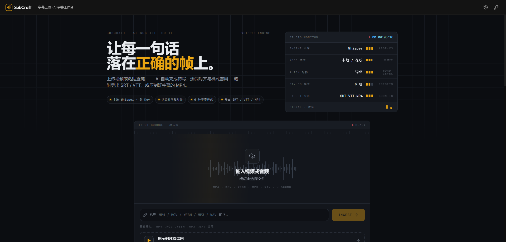

# 字幕工坊 SubCraft — AI 智能字幕



上传视频或粘贴媒体直链，自动生成带时间轴的字幕；支持在线编辑、样式预览，可选 AI 翻译与 AI 配音，
并导出 `.srt` / `.vtt` / 压制字幕的 `.mp4` / 配音混入的 `.mp4`。

语音识别支持两种模式：

- **本地 Whisper（推荐）** —— 用 [faster-whisper](https://github.com/SYSTRAN/faster-whisper) 在本机跑模型，**无需 API Key、音频不出本机**。
- **在线接口** —— 任意兼容 OpenAI `/audio/transcriptions` 的服务（Together AI、OpenAI、Groq、Fireworks…）。

> 一句话总结：**不填任何 Key，只启动本机 Whisper 服务，就能全流程离线出字幕**；翻译为可选在线功能。

---

## 目录

- [工作原理](#工作原理)
- [完整部署与使用流程](#完整部署与使用流程)
  - [方式一：本地跑通（推荐）](#方式一本地跑通推荐)
  - [方式二：Docker Compose 部署](#方式二docker-compose-部署)
  - [方式三：服务器直接运行 Node](#方式三服务器直接运行-node)
- [本地 Whisper 模型怎么配置](#本地-whisper-模型怎么配置)
- [FFmpeg 说明](#ffmpeg-说明)
- [在线语音识别（可选）](#在线语音识别可选)
- [字幕翻译与目标语言（可选）](#字幕翻译与目标语言可选)
- [AI 配音（可选）](#ai-配音可选)
- [环境变量](#环境变量)
- [常见问题 FAQ](#常见问题-faq)
- [反向代理（nginx）](#反向代理nginx)

---

## 工作原理

1. **导入** —— 上传视频文件，或粘贴媒体直链
2. **识别** —— FFmpeg 抽取音频，本地 Whisper 或在线接口生成带**词级时间戳**的字幕
3. **编辑与样式** —— 实时预览，内置 6 种样式（经典 / TikTok / 现代色块 / 电影感 / 描边 / 粗体居中）
4. **翻译（可选）** —— 调用在线大模型把字幕翻译成目标语言，可在编辑器一键还原原文
5. **配音（可选）** —— 用 TTS 把字幕合成为目标语言语音，按时间轴混入视频（可保留/压低原声）
6. **导出** —— 下载 `.srt`、`.vtt`，或导出压制字幕的 `.mp4` / 配音混入的 `.mp4`

数据流：`浏览器 → Next.js(/api/process → /api/transcribe) → 本地 Whisper 或在线接口 → 编辑器 → 导出`。

---

## 完整部署与使用流程

### 方式一：本地跑通（推荐）

> 目标：在个人电脑上不花一分钱、不填任何 Key，跑通「上传 → 出字幕 → 导出」。

**第 0 步：准备环境**

- Node.js 18+（`node -v` 检查）
- Python 3.9–3.12（运行本地 Whisper 用；若只用在在线接口可跳过）
- FFmpeg：系统已装并加入 PATH 即可，**无需额外 npm 安装**，详见 [FFmpeg 说明](#ffmpeg-说明)

**第 1 步：安装 Web 依赖**

```bash
git clone https://github.com/ak3489/subCraft.git
cd subCraft
npm install
cp .env.example .env   # 可全部留空，本地 Whisper 模式不需要任何 Key
```

**第 2 步：启动本地 Whisper 服务（新开一个终端）**

```bash
cd local-stt
# Windows：双击 run.bat；macOS/Linux：./run.sh
# 或手动：
python -m venv .venv
.venv\Scripts\activate          # macOS/Linux: source .venv/bin/activate
pip install -r requirements.txt
uvicorn server:app --host 0.0.0.0 --port 8000
```

看到 `Uvicorn running on http://0.0.0.0:8000` 即成功。首次识别会自动下载模型（`large-v3` 约 1.5GB），
国内网络可先设镜像 `HF_ENDPOINT=https://hf-mirror.com`。

**第 3 步：启动 Web 应用（回到项目根目录）**

```bash
npm run dev
```

打开 http://localhost:3000 。

**第 4 步：在网页里配置**

点击右上角 **「接口设置」**：

- 语音识别 → 选择 **「本地 Whisper」**
- 本地服务地址：`http://localhost:8000/v1`（已预填）
- 模型名称：`large-v3`（或你下载的模型，见下方[模型配置](#本地-whisper-模型怎么配置)）
- 无需填写 API Key；翻译按需开启（可选）

**第 5 步：正常使用**

1. 导入 → 上传视频或粘贴直链
2. 处理 → 自动抽音频并识别，生成字幕
3. 编辑 → 改文字、整体平移时间、查找替换、选样式
4. 翻译（可选）→ 右上角「翻译」，可「还原」原文
5. 导出 → 下载 `.srt` / `.vtt`，或压制字幕导出 `.mp4`

---

### 方式二：Docker Compose 部署

根目录的 `docker-compose.yml` 会**同时启动 Web 应用 + 本地 Whisper 服务**，无需手动装 Python/FFmpeg：

```bash
docker compose up -d --build
```

启动后：

- Web 应用：http://localhost:3000
- 本地 Whisper：容器内网 `http://local-stt:8000`，Web 侧已默认指向它
- 模型缓存持久化在 `whisper-models` 卷，临时文件在 `substudio-data` 卷

首次识别会拉取模型；如需加速或指定模型/设备，可用环境变量覆盖：

```bash
# 例如用 GPU + 更小的模型
STT_MODEL=medium STT_DEVICE=cuda STT_COMPUTE_TYPE=float16 docker compose up -d --build
```

使用 GPU 需在 compose 中为 `local-stt` 服务启用 nvidia runtime。

---

### 方式三：服务器直接运行 Node

要求：Node.js 18+、系统已安装 `ffmpeg`。本地识别需另行启动 `local-stt/`（或用在线接口）。

```bash
npm ci
npm run build
NODE_ENV=production FFMPEG_PATH=/usr/bin/ffmpeg npm run start
```

生产环境 `next start` 默认监听 `3000` 端口，建议放在 nginx 等反向代理后面（见下文）。

---

## 本地 Whisper 模型怎么配置

模型有 **两处** 可配，**网页里的值优先**（每次请求都会带上）：

| 配置位置 | 变量 / 字段 | 说明 |
| --- | --- | --- |
| 服务端默认 | `local-stt/.env` 里的 `STT_MODEL` | 网页未指定时用这个，默认 `large-v3` |
| 网页（优先） | 「接口设置 → 本地 Whisper → 模型名称」 | 随请求发送，覆盖服务端默认值 |

> 也就是说：模型名由网页里填的那个决定；服务端 `STT_MODEL` 只是兜底。

### 可用的 Whisper 版本（可下载）

本地识别基于 [faster-whisper](https://github.com/SYSTRAN/faster-whisper)。下表是它内置支持的全部短名，
可直接填进网页「模型名称」或服务端 `STT_MODEL`（短名会自动映射到对应的 Hugging Face 仓库）：

| 短名 | Hugging Face 仓库 | 体积 | 语言 | 说明 |
| --- | --- | --- | --- | --- |
| `tiny` | `Systran/faster-whisper-tiny` | ~75MB | 多语 | 最快，测试 / 低配机 |
| `tiny.en` | `Systran/faster-whisper-tiny.en` | ~75MB | 仅英文 | |
| `base` | `Systran/faster-whisper-base` | ~145MB | 多语 | |
| `base.en` | `Systran/faster-whisper-base.en` | ~145MB | 仅英文 | |
| `small` | `Systran/faster-whisper-small` | ~480MB | 多语 | CPU 日常首选 |
| `small.en` | `Systran/faster-whisper-small.en` | ~480MB | 仅英文 | |
| `medium` | `Systran/faster-whisper-medium` | ~1.5GB | 多语 | 质量 / 速度平衡 |
| `medium.en` | `Systran/faster-whisper-medium.en` | ~1.5GB | 仅英文 | |
| `large-v1` | `Systran/faster-whisper-large-v1` | ~3GB | 多语 | 旧版 |
| `large-v2` | `Systran/faster-whisper-large-v2` | ~3GB | 多语 | |
| `large-v3` / `large` | `Systran/faster-whisper-large-v3` | ~3GB | 多语 | 质量最高（默认） |
| `large-v3-turbo` / `turbo` | `mobiuslabsgmbh/faster-whisper-large-v3-turbo` | ~1.6GB | 多语 | 接近 large、快很多 |
| `distil-small.en` | `Systran/faster-distil-whisper-small.en` | ~350MB | 仅英文 | 蒸馏加速 |
| `distil-medium.en` | `Systran/faster-distil-whisper-medium.en` | ~800MB | 仅英文 | 蒸馏加速 |
| `distil-large-v2` | `Systran/faster-distil-whisper-large-v2` | ~1.5GB | 仅英文 | 蒸馏加速 |
| `distil-large-v3` | `Systran/faster-distil-whisper-large-v3` | ~1.5GB | 仅英文 | 蒸馏，英文推荐 |
| `distil-large-v3.5` | `distil-whisper/distil-large-v3.5-ct2` | ~1.5GB | 仅英文 | 最新蒸馏 |

> - 带 `.en` 与 `distil-*` 的模型**只针对英文**优化；中文等其他语言请用多语版本（如 `small` / `medium` / `large-v3`）。
> - 短名映射来自 faster-whisper 的 `_MODELS` 表，随库版本略有增减；填完整 Hugging Face 仓库名可绕开短名限制。

### 模型在哪里下载

- **来源**：模型权重托管在 **Hugging Face** 上，格式为 **CTranslate2（CT2）**。它与 OpenAI 原始的
  `openai/whisper-*`（`.pt` 格式）**不通用**，必须是 CT2 转换版。
- **位置**：首次使用某模型时，`huggingface_hub` 会自动从 `https://huggingface.co` 下载，并缓存到
  `STT_MODELS_DIR`（默认 `local-stt/models`，Docker 里是 `/models` 卷）。
- **是否联网**：下载后**同一模型不再联网**；只有换模型、改 revision 或清缓存时才会重新下载。
- **也可以填仓库名**：任何 Hugging Face 上的 CT2 仓库都行，例如 `deepdml/faster-whisper-large-v3-turbo-ct2`。
- 日志里出现 `GET https://huggingface.co/api/models/Systran/faster-whisper-<模型>/...` 的请求属**正常现象**，
  返回 `200 OK` 即表示网络正常。

**⚠️ 国内网络提示（重要）**：`huggingface.co` 在国内常常**访问不通畅（超时 / 很慢）**，
首次下载模型前建议先按下面任一方式解决，否则会一直卡在下载。任选其一：

1. **国内镜像（推荐）**：设 `HF_ENDPOINT=https://hf-mirror.com` —— 在 `local-stt/.env` 里加一行，
   或启动服务前临时设置（Windows `$env:HF_ENDPOINT="https://hf-mirror.com"`，macOS/Linux
   `export HF_ENDPOINT=https://hf-mirror.com`），重启服务即可；`huggingface_hub` 会自动走镜像。
   Docker Compose 中给 `local-stt` 服务加环境变量 `HF_ENDPOINT: https://hf-mirror.com` 即可。
2. **走代理**：设置 `HTTP_PROXY` / `HTTPS_PROXY` 环境变量。
3. **手动下载后离线使用**（镜像 / 内网都适用）：

   ```bash
   HF_ENDPOINT=https://hf-mirror.com huggingface-cli download Systran/faster-whisper-large-v3 --local-dir <目录>
   ```

   注意：**必须下整份**，关键文件 `config.json`、`model.bin`、`preprocessor_config.json`、
   `tokenizer.json`、`vocabulary.json` 缺一不可；下好后把网页「模型名称」/ `STT_MODEL` 填成**该目录路径**，
   或按 HF 缓存结构放进 `STT_MODELS_DIR`。

> 补充：仓库要选 **CT2 格式**的（`Systran/faster-whisper-*`、`Systran/faster-distil-whisper-*`、
> `mobiuslabsgmbh/faster-whisper-large-v3-turbo` 等），**不要用 `openai/whisper-*`**——那是 PyTorch 格式，
> faster-whisper 用不了。另外网页「模型名称」/ `STT_MODEL` 也可以直接填**完整仓库名**
> （如 `Systran/faster-whisper-large-v3`），效果与短名一致。

**设备与精度**（`local-stt/.env`）：

- `STT_DEVICE=cpu`（默认）或 `cuda`
- `STT_COMPUTE_TYPE=int8`（CPU 默认）/ `float16`、`int8_float16`（GPU 常用）
- `STT_MODELS_DIR=./models` 模型缓存目录（Docker 里是 `/models` 卷）(STT_MODELS_DIR=G:/gcz/video-translator-py/models)
- `STT_VAD=true` 是否用 VAD 过滤静音

**性能建议**：CPU 上 `large-v3` 约为音频时长的数倍，建议先用 `small`/`medium`/`large-v3-turbo`；
有 NVIDIA 显卡时设 `STT_DEVICE=cuda`、`STT_COMPUTE_TYPE=float16` 会快很多，并在 Docker 中启用 GPU。

---

## FFmpeg 说明

**电脑已装 FFmpeg 的话，不需要再单独用 npm 装 FFmpeg。** 程序按以下顺序自动查找可执行文件：

1. 环境变量 `FFMPEG_PATH`（自建服务器推荐，如 `/usr/bin/ffmpeg`）
2. npm 包 `@ffmpeg-installer/ffmpeg` 自带的二进制（随 `npm install` 默认安装，按平台）
3. 系统 `PATH` 中的 `ffmpeg`

所以：

- **只是想能正常用** → 系统 `PATH` 里有 `ffmpeg` 即可，无需任何额外操作（npm 自带的那个也能用，效果一样）。
- **想强制用你系统自己的 ffmpeg** → 在 `.env` 里设 `FFMPEG_PATH=D:\ffmpeg\bin\ffmpeg.exe`。
- **想彻底不装 npm 自带的 ffmpeg 二进制** → 用 `npm install --omit=optional` 安装依赖即可跳过它，程序会回退到系统 ffmpeg（平台二进制是可选依赖 `optionalDependencies`）。
- 注意：`npm install` 本身仍然需要（要装 Next.js、React 等依赖），这里说的「不用 npm 装」仅指 FFmpeg。

Docker 镜像内已安装系统 ffmpeg 并设置 `FFMPEG_PATH=/usr/bin/ffmpeg`，无需操心。

验证是否生效：`ffmpeg -version` 能输出版本即可；日志里若出现 `[ffmpeg] 设置 ffmpeg 路径失败…`，说明回退到了系统 `PATH`。

---

## 在线语音识别（可选）

在「接口设置」里切换到**在线接口**，填写接口地址 / API Key / 模型名称。接口需满足：

- 兼容 OpenAI `POST /audio/transcriptions`
- 支持 `response_format: "verbose_json"` 与 `timestamp_granularities: ["word"]`（**词级时间戳**）

满足的示例：Together AI、OpenAI（`whisper-1`）、Groq、Fireworks，以及自建的 faster-whisper / vLLM 等。

> 若供应商只返回纯文本（如 SiliconFlow），程序会自动降级为按字数估算时间轴，准确度较低。
> DeepSeek 没有语音转写接口，不能用于识别。

---

## 字幕翻译与目标语言（可选）

在「接口设置 → 字幕翻译」里开启，填写任意兼容 OpenAI `/chat/completions` 的接口
（如 SiliconFlow、DeepSeek），然后选择**目标语言**。

- **默认目标语言**：`中文`
- **可选预设**：中文 / English / 日本語 / 한국어 / Français / Deutsch / Español / Русский
- **自定义**：目标语言输入框可直接输入任意语言（如 `繁體中文`、`Italiano`），会原样传给模型

识别完成后，在编辑器右上角点 **「翻译」** 即可生成目标语言字幕；点 **「还原」** 可切回原文。
翻译配置与识别配置互相独立，识别用本地、翻译用在线即可。

---

## AI 配音（可选）

把翻译后的字幕合成为目标语言语音，并按字幕时间轴对齐后混入视频 —— 即「生成目标语言并压制进视频」。

在「接口设置 → 配音」里开启，填写任意兼容 OpenAI `/audio/speech` 的接口
（如 SiliconFlow 的 `FunAudioLLM/CosyVoice2-0.5B`、OpenAI 的 `tts-1`），并选择音色。

- **保留原声**：开启后原音轨会被压低，与新配音混合；可用滑块设置降低的音量（默认 `-18 dB`）。
- **关闭保留原声**：原音轨被完全替换为目标语言配音。
- 完成后，在编辑器「导出」下拉里选择 **「AI 配音 MP4」** 导出即可。
- 视频画面直接复制不重编码，导出速度很快；配音按每条字幕的起止时间定位，重叠时自动混音。

> 配音使用当前编辑器里的字幕文本（通常先点「翻译」再配音）。
> 建议先配置好翻译接口与配音接口，二者可分别使用不同供应商。

---

## 环境变量

复制 `.env.example` 为 `.env` 后按需填写（本地 Whisper 模式下可全部留空）。

| 变量 | 说明 | 默认值 |
| --- | --- | --- |
| `TRANSCRIBE_BASE_URL` | 服务端默认转写接口（网页设置优先） | `https://api.together.xyz/v1` |
| `TRANSCRIBE_API_KEY` | 在线转写 Key（本地模式无需） | 空 |
| `TRANSCRIBE_MODEL` | 转写模型名称 | `openai/whisper-large-v3` |
| `TOGETHER_API_KEY` | 兼容旧配置，未填 `TRANSCRIBE_API_KEY` 时回退读取 | 空 |
| `TRANSLATE_BASE_URL` | 翻译接口地址（可选） | `https://api.siliconflow.cn/v1` |
| `TRANSLATE_API_KEY` | 翻译 API Key（可选） | 空 |
| `TRANSLATE_MODEL` | 翻译模型名称（可选） | `Qwen/Qwen2.5-7B-Instruct` |
| `DUB_BASE_URL` | 配音（TTS）接口地址（可选） | `https://api.siliconflow.cn/v1` |
| `DUB_API_KEY` | 配音 API Key（可选） | 空 |
| `DUB_MODEL` | 配音模型名称（可选） | `FunAudioLLM/CosyVoice2-0.5B` |
| `DUB_VOICE` | 配音默认音色（可选） | `alex` |
| `FFMPEG_PATH` | 指定 ffmpeg 可执行文件路径 | 自动探测 |
| `TEMP_STORAGE_DIR` | 临时文件目录（生产环境建议挂载持久卷） | `/tmp/substudio` |
| `NEXT_PUBLIC_SITE_URL` | 站点地址，用于 OG 图片 / sitemap 绝对链接 | `http://localhost:3000` |
| `BLOB_READ_WRITE_TOKEN` | 可选，Vercel Blob（自建服务器一般不需要） | 空 |

> `BLOB_READ_WRITE_TOKEN` 未配置时，前端会直接上传到 `/api/process`，无需对象存储。

本地 Whisper 服务自身的变量见 [`local-stt/.env.example`](./local-stt/.env.example)：
`STT_MODEL` / `STT_DEVICE` / `STT_COMPUTE_TYPE` / `STT_BEAM_SIZE` / `STT_MODELS_DIR` / `STT_VAD` / `STT_HOST` / `STT_PORT` / `HF_ENDPOINT`。

---

## 常见问题 FAQ

**Q1：翻译的目标语言可以设置吗？**
可以。在「接口设置 → 字幕翻译 → 目标语言」里选择预设语言，或直接输入任意语言。
默认翻译成中文。详见 [字幕翻译与目标语言](#字幕翻译与目标语言可选)。

**Q2：我电脑已经装了 FFmpeg，还需要 npm 安装吗？**
FFmpeg **不需要**再通过 npm 安装——系统 `PATH` 里有 `ffmpeg` 就能用（顺序：`FFMPEG_PATH` → npm 自带 → 系统）。
但 `npm install`（装 Next.js 等依赖）**仍然需要**。想强制用系统 ffmpeg 就设 `FFMPEG_PATH`，想不装 npm 自带的二进制就用 `npm install --omit=optional`。
详见 [FFmpeg 说明](#ffmpeg-说明)。

**Q3：本地 Whisper 模型怎么配置？**
两处：`local-stt/.env` 的 `STT_MODEL`（服务端默认）和网页「模型名称」（优先）。
cuda/int8 等用 `STT_DEVICE`/`STT_COMPUTE_TYPE`。详见 [本地 Whisper 模型怎么配置](#本地-whisper-模型怎么配置)。

**Q4：识别什么时候会用到 Key？**
只有「在线接口」模式需要 Key；「本地 Whisper」模式完全不需要，音频不出本机。

**Q5：首次识别很慢 / 卡在下载？**
本地模式首次会从 Hugging Face 下载模型（`large-v3` 约 1.5GB），属正常现象；下载后缓存到 `STT_MODELS_DIR` 不再联网。
国内可设 `HF_ENDPOINT=https://hf-mirror.com`。CPU 上 `large-v3` 本身也慢，建议换 `small`/`medium`/`large-v3-turbo`。
详见 [模型在哪里下载](#模型在哪里下载)。

**Q6：支持哪些 Whisper 模型版本？**
faster-whisper 支持的短名有 `tiny` / `base` / `small` / `medium` / `large-v1` / `large-v2` / `large-v3` / `large-v3-turbo`
（另有 `.en` 英文版与 `distil-*` 蒸馏版）。完整列表与对应的 Hugging Face 仓库见
[可用的 Whisper 版本](#可用的-whisper-版本可下载)。

**Q7：报错 `open() got an unexpected keyword argument 'metadata_errors'`？**
PyAV 19 的破坏性变更，`local-stt/requirements.txt` 已用 `av<19` 规避；手动装过 `av` 的话执行 `pip install "av<19"`。

**Q8：Docker 里 Web 怎么连到本地 Whisper？**
Compose 中 Web 默认 `TRANSCRIBE_BASE_URL=http://local-stt:8000/v1`（容器内网服务名）。

---

## 反向代理（nginx）

- 上传体积上限为 **500MB**，请确保 `client_max_body_size` 足够大（如 `client_max_body_size 500m;`）。
- 转写 / 压制接口耗时较长，请调大 `proxy_read_timeout`（如 `300s`）。

---

## 技术栈

- **框架**：[Next.js](https://nextjs.org/)（App Router）
- **本地识别**：[faster-whisper](https://github.com/SYSTRAN/faster-whisper) + FastAPI（见 `local-stt/`）
- **在线识别/翻译**：任意兼容 OpenAI 的服务
- **动画**：[Framer Motion](https://www.framer.com/motion/)
- **样式**：[Tailwind CSS](https://tailwindcss.com/)
- **视频处理**：FFmpeg（通过 `fluent-ffmpeg`）

## License

MIT
